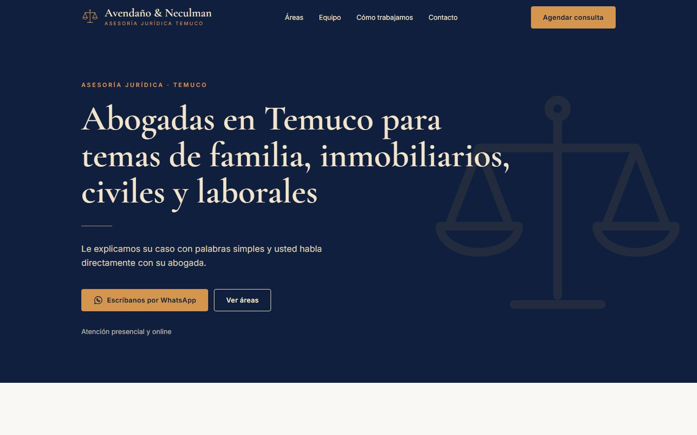

# Avendaño & Neculman · Asesoría Jurídica Temuco

Sitio web de una sola página para **Avendaño & Neculman**, un estudio jurídico real de Temuco (Chile) que funciona desde 2023. Abogadas de familia, inmobiliario, civil y laboral, con atención presencial en Temuco y online para todo Chile.

> **Proyecto con cliente real.** Los datos del estudio son reales. Los testimonios del repositorio son textos de ejemplo: solo se ven en desarrollo y nunca se publican.

**🔗 Sitio en vivo:** https://asesoriajuridicatco.netlify.app

<p>
  
  
</p>

## Qué incluye

- **Diseño minimalista:** fondo claro, azul solo en header, hero y footer; títulos serif grandes, sin sombras ni degradados, un objetivo por pantalla: agendar una consulta.
- **9 bloques:** header con menú móvil, hero, materias, equipo, cómo trabajamos, atención online, testimonios (desactivados), preguntas frecuentes, contacto con mapa y footer.
- **WhatsApp como canal principal:** botones con el mensaje ya escrito y botón flotante solo en móvil.
- **Formulario de contacto** con [Netlify Forms](https://docs.netlify.com/forms/setup/): validación nativa, casilla de privacidad obligatoria, campo anti-spam y página `/gracias`.
- **Página `/privacidad`** que explica qué datos se piden, para qué y cómo ejercer los derechos (Ley 19.628 y Ley 21.719).
- **Testimonios protegidos:** la sección solo se publica si `showTestimonials` es `true` y hay testimonios reales; los de ejemplo se filtran en producción.
- **Responsive, mobile-first:** probado en 375, 768, 1024 y 1440 px.
- **Accesible:** HTML semántico, un solo `h1`, contraste AA medido par por par (el dorado del logo solo se usa sobre azul), foco visible y navegación con teclado.
- **SEO local:** título y descripción con "Temuco" y "online", `lang="es-CL"`, Open Graph, sitemap, `robots.txt` y JSON-LD `LegalService` con cada abogada como `Person` (`worksFor`).
- **Rápido:** cero JavaScript salvo el menú móvil, fuentes servidas desde el propio sitio y mapa con carga diferida.

### Lighthouse (móvil, build de producción)

| Rendimiento | Accesibilidad | Buenas prácticas | SEO |
| :---------: | :-----------: | :--------------: | :-: |
|     100     |      100      |       100        | 100 |

## Stack

| Pieza      | Elección                                                           |
| ---------- | ------------------------------------------------------------------ |
| Framework  | [Astro 7](https://astro.build) + TypeScript estricto               |
| Estilos    | [Tailwind CSS v4](https://tailwindcss.com) vía `@tailwindcss/vite` |
| Fuentes    | Cormorant Garamond e Inter, con la API de fuentes de Astro         |
| Mapa       | Google Maps (iframe con carga diferida, sin clave de API)          |
| Formulario | Netlify Forms                                                      |
| Formato    | Prettier con los plugins de Astro y Tailwind                       |
| Despliegue | Netlify                                                            |

## Cómo correrlo

Requiere **Node 22.23 o superior**.

```bash
npm install
npm run dev
```

Abre http://localhost:4321.

| Comando           | Qué hace                                      |
| ----------------- | --------------------------------------------- |
| `npm run dev`     | Servidor local con recarga automática         |
| `npm run build`   | Compila el sitio a `dist/`                    |
| `npm run preview` | Sirve el build para probarlo antes de subirlo |
| `npm run check`   | Revisa los tipos de TypeScript                |
| `npm run format`  | Formatea todo el código con Prettier          |

> El formulario solo envía en Netlify. En local, enviarlo da error y es normal.

## Estructura

```
src/
├── assets/images/   fotos del equipo (Astro las optimiza a WebP)
├── components/      una sección por componente + ui/ (Button, SectionTitle, Icon, Scales)
├── data/            todos los textos y datos: site, materias, equipo, pasos, FAQ, testimonios, privacidad
├── layouts/         BaseLayout: <head>, SEO, Open Graph y JSON-LD
├── lib/             enlaces (WhatsApp, mapa), imágenes y formato de precios
├── pages/           index (solo ensambla secciones), privacidad, gracias y robots.txt
└── styles/          global.css: tema con @theme y estilos base
```

Ningún texto, dato de contacto ni enlace está escrito dentro de los componentes: todo vive en `src/data/`.

## Publicar en Netlify

1. En [Netlify](https://app.netlify.com): **Add new site → Import an existing project → GitHub** y elegir este repositorio. `netlify.toml` ya trae el comando y la carpeta de salida.
2. En **Site configuration → Change site name**, poner `asesoriajuridicatco`. Así la URL queda `https://asesoriajuridicatco.netlify.app`, la misma de `astro.config.mjs`.
3. En **Forms**, activar la detección de formularios (_Enable form detection_) y volver a desplegar.
4. En **Forms → Form notifications → Add notification → Email notification**, elegir el formulario `consultas` y poner `asesorialegal.tco@gmail.com`.
5. Enviar un mensaje de prueba desde el sitio en vivo y confirmar que llega al Gmail del estudio (revisar también Spam).

### Después de publicar

- Validar el JSON-LD en el [Validador de Schema.org](https://validator.schema.org) con la URL en vivo.
- Crear o actualizar la ficha de **Google Business Profile** con los mismos datos, escritos de forma idéntica.
- **Dominio propio (.cl o .com):** agregarlo en Netlify (_Domain management_) y cambiar `site` en `astro.config.mjs`. De ahí salen las URLs del sitemap, el JSON-LD y Open Graph.

## Pendientes del estudio

- Logo original en alta resolución (el actual es provisorio) y fotos de las abogadas (`src/assets/images/` + `photo.file` en `src/data/team.ts`).
- Aprobar los textos: casos típicos por materia, biografías, eslogan y política de privacidad.
- URL completa de la página de Facebook para el JSON-LD (`profileUrl` en `src/data/site.ts`).
- Testimonios reales con autorización escrita; luego `showTestimonials: true`.
- Autorización escrita para mostrar el sitio en el portafolio.

## Siguiente paso

Una página por materia (`/familia`, `/inmobiliario`, `/civil`, `/laboral`), que es lo que más ayuda al SEO local.

---

Sitio desarrollado por **Daniel y Tere** · [GitHub](https://github.com/danielyteresa)
